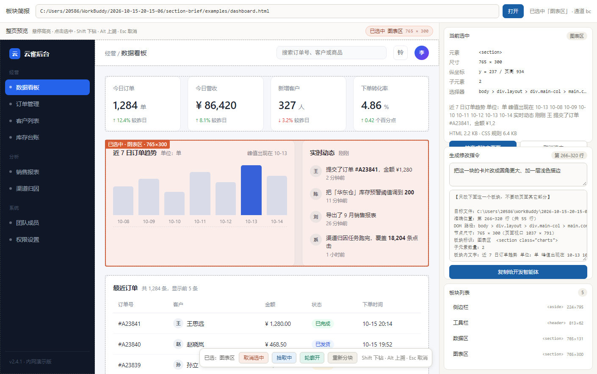

# SectionBrief · 板块简报

> **Brief your coding agent, one section at a time.**
> 把页面切成板块，选中一块，给你的编码智能体一份"只改这块"的交接说明。

自动把前端页面切成板块，在预览里点选其中一块，生成一段带**精确文件路径和行号**的
「只改这一块」指令，交给正在改这个项目的 AI 智能体。

零安装。不装浏览器扩展、不装 npm 包、不改你的项目一行代码。



[English →](README.md)

---

## 解决什么问题

想改页面上某一块时，你只能用嘴描述：

> "价格表下面那张灰色的卡片，左数第二个……改成整行宽"

智能体只能猜你指的是哪个元素、以及是哪个文件渲染的。它会把轮次烧在搜索上，
有时候改错实例，还常常顺手动到旁边你根本没要求改的板块。

指一下元素，解决了前半个问题。知道**哪个文件、第几行**，才解决后半个。

## 工作流

```
页面  →  自动切成板块  →  你选一块  →  一份严格的指令  →  你的智能体
```

1. 本地 Node 服务托管目标 HTML、注入拾取脚本，并给**每个元素标注它在源文件里的行号范围**
   —— 源文件本身全程只读，不改动。
2. 页面按自顶向下的规则切成带名字的板块（页头 / Hero / 图表区 / 数据表 / 页脚……）。
3. 你点一下板块。它的尺寸、样式、选择器和**行号范围**出现在右侧面板。
4. 写清想怎么改，复制，粘进你的智能体。

## 和同类工具的差异

| | LocatorJS · ClickToComponent · code-inspector-plugin | AgentGrab · oil-oil/selector · UI Context for Agents | React Grab · see-my-clicks · mcp-pointer | **SectionBrief** |
|---|---|---|---|---|
| 安装方式 | 构建插件 | 浏览器扩展 / 书签小工具 | npm 包 或 MCP server | **不用装** |
| 跑在智能体的内置预览里 | ✗ | ✗ | ✗ | **✓** |
| 整页板块总览 | ✗ | ✗ | ✗ | **✓** |
| 纯静态 HTML 上给行号 | ✗（只认框架） | ✗（只认框架 dev build） | ✗（只认框架） | **✓** |
| 生成修改指令 | ✗（只跳 IDE） | ✓ | 部分 | ✓ |
| 抽离板块成独立沙盒 | ✗ | ✗ | ✗ | ✓ |

行号引擎是这里最值得一提的部分。能显示 `file:line` 的工具，都是从框架元数据里掏的
—— React 的 `fiber._debugSource`、Vue 的 `__vueParentComponent.type.__file`。
这在 dev build 里很好用，在**纯手写 HTML 上完全无效**。

SectionBrief 走的是相反的路线：在页面被托管出去**之前**就标注原始源码，
所以静态 HTML 能拿到精确行号；框架页面则退化成 CSS 选择器。

---

## 快速开始

零依赖，只用 Node 内置模块。

```bash
node server.mjs
# [section-brief] 已启动 http://127.0.0.1:7788/
```

打开 `http://127.0.0.1:7788/?src=<你的 HTML 绝对路径，URL 编码>`。

如果页面有自己的后端（它会向同源的 `/api/...` 发请求），把代理指向那个后端，
预览里它才能正常工作：

```bash
node server.mjs --upstream http://127.0.0.1:8770
```

未命中的路径会原样转发给上游。转发时会剥掉 `accept-encoding`，
避免响应体和 `content-encoding` 对不上导致前端解不开。

### 用自带的示例页试

```bash
node server.mjs
# 然后打开
#   http://127.0.0.1:7788/?src=<仓库>/examples/dashboard.html
#   http://127.0.0.1:7788/?src=<仓库>/examples/demo.html
```

`examples/dashboard.html` 切出 5 块，`examples/demo.html` 切出 7 块，都验证过零误差。

## 界面操作

| 操作 | 效果 |
|---|---|
| 悬停 | 光标下的板块被虚线框出，角上显示名称和尺寸 |
| 点击 | 选中（橙色框），右侧面板列出详情 |
| `Shift` + 点击 | 下钻到子板块 |
| `Alt` + 点击 | 上溯到父级 |
| `Esc` / 工具条按钮 / 面板按钮 | 取消选中 |
| 「抽离成独立页面」 | 生成只含这一块的沙盒 |
| 「生成修改指令」 | 填诉求，一键复制指令 |

## 生成的指令

真实输出，选自单文件 HTML 页面的 `.stats` 区块：

```text
【只改下面这一个板块，不要动页面其它部分】

目标文件：D:\project\index.html
准确位置：第 185–191 行（共 7 行）
DOM 路径：body > div.wrap > div.stats
节点尺寸：1005 × 91（页面视口 1037 × 791）
板块标识：数据区  <div class="stats">
子元素数量：5
板块内文字：延迟 Ping—ms 抖动 Jitter—ms 丢包 Loss—% 已用流量0MB 评级—

当前关键样式：
  display: grid
  …

【我想怎么改】
<你填写的诉求>

【硬性约束】
1. 只改这一个板块对应的代码，不要改其它板块的结构和样式。
2. 如果这次改动会波及别的区域，先说明影响范围，再动手。
3. 保持项目现有的代码风格和命名习惯，不要顺手重构无关代码。
4. 改完告诉我具体改了文件的哪几行。
```

文件路径和行号是人工核对过的 —— 第 185 行是 `<div class="stats">` 的开始标签，
第 191 行是对应的闭合标签。

## 实现方式

| 组件 | 文件 | 职责 |
|---|---|---|
| 本地服务 | `server.mjs` | 托管调试台、代理目标页并注入、生成沙盒、暴露状态 |
| 拾取脚本 | `public/inject.js` | 分块、悬停高亮、点击选中、键盘操作 |
| 调试台 | `public/index.html` + `tool.js` + `tool.css` | 左侧整页预览，右侧选中详情 + 沙盒 + 指令 |
| 自检探针 | `scripts/probe.mjs` | 无头浏览器模拟点击，回归验证整条链路 |
| 对比探针 | `scripts/compare-probe.mjs` | 端到端驱动调试台，读回真实生成的指令 |

**同源代理。** 目标页由本地服务托管、以 iframe 加载，于是调试台和页面同源，
可以直接检查 DOM。没有跨域问题。

**源文件只读。** 服务读取你的文件、注入 `<base>` 和拾取脚本、把结果吐给浏览器。
磁盘上的源文件不会被改动。

**行号标注。** 在注入任何东西之前先扫一遍源码：每个开始标签插 `data-wb-l="<行号>"`，
每个结束标签插 `data-wb-e="<行号>"`。插入的属性不含换行，所以行号不会漂移。
`<script>` / `<style>` / `<textarea>` / `<title>` 的内容区整体跳过，
所以脚本里的 `a < b` 不会被误判成标签。任何 HTML 离开这个工具之前都会剥掉 `data-wb-*`。

**三条冗余通道。** `BroadcastChannel`、`postMessage`，外加 700ms 轮询 `/api/state`。
内嵌预览的 webview 有时会掐掉前两条；轮询只依赖本地服务，所以调试台照样能同步。

### 分块算法

自顶向下遍历 DOM：

1. 没有子节点 → 这是一个板块
2. 只有一个子节点 → 若该节点有语义名字且足够高就停下，否则继续下钻
3. 有多个子节点 → 纵向堆叠（每个孩子宽度 ≥ 容器 72%）、横向分栏
   （2~3 个孩子且每个高度 ≥ **视口** 的 60%），两者都不满足则整个容器算一块
4. 超过 1.0 倍视口高度的块继续下钻，最深 4 层

### API

| 方法 | 路径 | 用途 |
|---|---|---|
| GET | `/api/health` | 健康检查，返回实际端口与已配置的上游 |
| GET | `/api/state` | 目标 + 选中摘要 + 最近 20 条 |
| GET | `/api/selection` | 当前选中的完整数据（含 HTML 与 CSS） |
| POST | `/api/state` | 写状态；`{clear:true}` 清空选中 |
| POST | `/api/target` | 设置目标文件 |
| POST | `/api/export` | 按选中内容生成沙盒 |
| GET | `/preview?src=` | 代理目标页并注入拾取脚本 |
| GET | `/sandbox/<id>/index.html` | 访问生成的沙盒 |

## 已知限制

- **只吃单文件本地 HTML。** dev server、带外链资源的多文件项目尚未做代理。
- **写死的绝对路径不走 `<base>`。** 硬编码的 `/style.css` 会 404。
- **抽离的沙盒可能丢样式**：样式若来自后代选择器而祖先链被脱掉，规则就不匹配了。
  目前沙盒会带上整页的 CSS。
- **行号只对静态 HTML 可靠。** JS 动态创建或重排的节点对不上号，此时工具会提示
  「未定位到行号」，退化成只给 CSS 选择器。
- **回写源文件未实现。** 抽离产物落在 `out/`，是独立沙盒，原项目不会被改动。
- **GBK 编码的页面** 会被按 UTF-8 读，中文乱码。
- **分块粒度比自由点元素粗。** 并排的两张卡片各自不足一屏时算作一块，
  `Shift` + 点击可下钻到单张。
- 与 `/api/health|state|selection|target|export` 撞名的路径无法转发到上游，
  也不转发 WebSocket 升级。

## 相关工作

本项目参考过的前人工作，以及差异所在：

- [AgentGrab](https://github.com/PaulHarrer/agentgrab) —— 元素拾取 → 剪贴板提示词。
  理念最接近；它是浏览器扩展，且源码线索来自框架 dev build。
- [oil-oil/selector](https://github.com/oil-oil/selector) —— 书签小工具，多选、逐元素批注。
- [LocatorJS](https://github.com/infi-pc/locatorjs)、
  [ClickToComponent](https://github.com/ericclemmons/click-to-component)、
  `code-inspector-plugin` —— 从组件跳到 IDE。它们的源码位置注入是框架页面的正确解法。
- [React Grab](https://github.com/aidenybai/react-grab)、
  [see-my-clicks](https://www.npmjs.com/package/see-my-clicks)、
  [mcp-pointer](https://github.com/greenstevester/mcp-pointer) —— 项目级安装与 MCP 传输。

其中 AgentGrab 与本工具在同一页面、同一元素上的实测对比见 `docs/comparison.md`。

## 许可证

[MIT](LICENSE)
